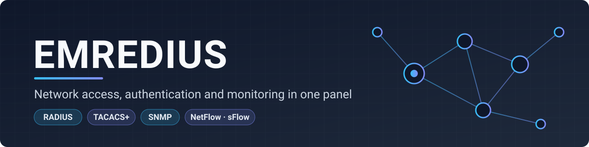
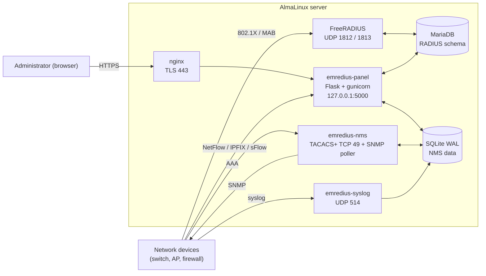

<div align="center">

**English** · **[Türkçe](README.tr.md)**



<br>


[](https://github.com/sponsors/emreyigit-tasdelen)
[](https://buymeacoffee.com/emreyigit.tasdelen)

**RADIUS user management, a TACACS+ AAA server and SNMP-based network monitoring (NMS) in a single web panel.**
802.1X and MAC authentication, device discovery, topology, NetFlow/sFlow, syslog, alarms and a signed log archive compliant with Turkish Law No. 5651.

[Quick start](#-quick-start) · [Architecture](#-architecture) · [Features](#-features) · [Configuration](#-configuration) · [API](#-rest-api) · [Docs](#-documentation)

</div>

---

## What is it for?

An enterprise network raises three separate questions: *who may connect* (RADIUS, 802.1X), *which commands may administrators run on a device* (TACACS+), and *how is the network behaving right now* (SNMP, flows, syslog). EMREDIUS puts them in one panel instead of splitting them across tools, and links them together: you can go from a MAC address to a device port, then to the RADIUS session and the user.

- **It sits next to FreeRADIUS, not in front of it.** The panel manages FreeRADIUS's own SQL schema; authentication keeps working while the panel is down.
- **Everything runs on AlmaLinux as separate systemd processes**; shared storage is MariaDB (RADIUS) and SQLite WAL (NMS).
- **Secure by default:** CSRF protection, role-based access control, two-factor authentication, per-IP login lockout, security headers, audit log of all actions.

## 🏗 Architecture



| Process | Entry point | Port | Role |
|---|---|---|---|
| `emredius-panel` | `wsgi:app` (gunicorn, 1 worker x 16 threads) | 127.0.0.1:5000 (behind nginx) | web UI, REST API, flow collector (UDP 2055, 4739, 6343) |
| `emredius-nms` | `python -m nms.runner` | TCP 49, SNMP poller | TACACS+ AAA, discovery, telemetry, alarms |
| `emredius-syslog` | `python -m nms.syslogd` | UDP 514 | syslog collection |
| FreeRADIUS | system package | UDP 1812 / 1813 | 802.1X / MAB authentication and accounting |
| systemd timers | `scripts/maintenance.py`, `scripts/update_oui.py`, `scripts/backup_verify.sh` | - | daily 5651 archive, monthly OUI table, backup restore test |

Design rationale, panel layers, sequence diagrams (RADIUS, TACACS+, SNMP discovery), state machines and ER diagrams: **[docs/architecture.md](docs/architecture.md)** (Turkish).

## ✨ Features

| Area | What is included |
|---|---|
| **Authentication** | RADIUS users/groups/profiles, NAS, MAC authentication, voucher generation, sessions, TACACS+ (PAP/CHAP/ASCII, privilege levels 0-15, regex command authorization, command accounting), RADIUS test tool |
| **Discovery and inventory** | SNMP CIDR discovery (v2c/v3), inventory and scheduled range scans, IP and port scanning, IPAM |
| **Network visibility** | LLDP/CDP topology map, port and MAC tables, chassis/module info, equipment health and traffic, loop detection, MAC scan and MAC alarms |
| **Traffic and events** | NetFlow v5/v9, IPFIX and sFlow analysis, syslog, threshold-based alarms, SIEM and integrations, service health |
| **Management** | device config backup and diff, config compliance, reports, custom boards, backups, multi-tenancy, editable permission matrix, hardening settings |
| **Compliance** | action audit log, daily signed 5651 log archive with verification |
| **UI** | dark/light theme, mobile friendly, live updates, CSV/JSON export, multilingual interface |

Menu → URL → service → template → test mapping: [docs/MODULES.md](docs/MODULES.md).

## 🧰 Tech stack

| Component | Technology | Version | Role |
|---|---|---|---|
| Language | Python | 3.12 | all panel and NMS code |
| Web | Flask, Jinja2, Werkzeug | 3.1.3, 3.1.6, 3.1.9 | application, templates |
| Server | gunicorn (gthread) | 23.0.0 | WSGI, single worker + 16 threads |
| RADIUS store | MariaDB + PyMySQL | PyMySQL 1.1.1 | FreeRADIUS schema |
| NMS store | SQLite (WAL) | ships with Python | inventory, telemetry, alarms, syslog, flows |
| Cryptography | cryptography, bcrypt, PyNaCl | 50.0.0, 5.0.0, 1.6.2 | SNMPv3, TACACS+, password hashes |
| SSH | paramiko | 5.1.0 | device config backup and CLI |
| Network protocols | own asyncio implementations | - | TACACS+ (RFC 8907), SNMPv2c/v3, NetFlow/IPFIX/sFlow parsers |
| System | nginx, systemd, firewalld, SELinux | - | TLS, processes, network filtering |

## 🚀 Quick start

Development environment (no database needed; tests are written to run against an unreachable DB):

```bash
git clone https://github.com/emreyigit-tasdelen/EMredius.git
cd EMredius
python -m venv .venv && source .venv/bin/activate     # Windows: .venv\Scripts\activate
pip install -r requirements.txt pytest

python -m pytest -q tests/test_core.py                # 19 tests, about 35 s
```

To start the panel's development server (the login page opens; account verification and most menus need MariaDB and Linux accounts):

```bash
EMREDIUS_ENV_FILE=/dev/null SECRET_KEY=$(python -c "import secrets;print(secrets.token_hex(32))") \
SESSION_COOKIE_SECURE=0 START_BACKGROUND_JOBS=0 python wsgi.py
# → http://127.0.0.1:5100/login
```

For server setup (AlmaLinux, MariaDB, FreeRADIUS, nginx, systemd) see [docs/KURULUM.md](docs/KURULUM.md) (Turkish). Unit files are under `deploy/systemd/`:

```bash
systemctl enable --now emredius-panel.socket emredius-panel.service emredius-nms emredius-syslog
```

## ⚙️ Configuration

Settings are read from environment variables; `KEY=VALUE` lines in `EMREDIUS_ENV_FILE` (default `/etc/emredius/emredius.env`) fill in any variable that is not already defined. Example: [`deploy/emredius.env.example`](deploy/emredius.env.example).

<details>
<summary>Environment variable table</summary>

| Variable | Default | Description |
|---|---|---|
| `EMREDIUS_ENV_FILE` | `/etc/emredius/emredius.env` | path of the environment file |
| `SECRET_KEY` / `SECRET_KEY_FILE` | `/etc/emredius/secret_key` | session key; generated into the file with mode 0600 if missing |
| `SESSION_COOKIE_SECURE` | `1` | cookie is not sent over plain HTTP |
| `DB_HOST`, `DB_PORT` | `127.0.0.1`, `3306` | MariaDB address |
| `DB_USER`, `DB_NAME` | `radius`, `radius` | MariaDB user and schema |
| `DB_PASSWORD` | (none) | if not given, read from the FreeRADIUS `sql` module configuration |
| `DB_POOL_SIZE` | `8` | connection pool size |
| `NMS_DB_PATH` | `nms/data/enterprise_nms.db` | NMS SQLite file |
| `START_BACKGROUND_JOBS` | `1` | schedulers and collectors |
| `SYSTEM_DRY_RUN` | `0` | when `1`, commands that modify the server are blocked (staging) |
| `ARCHIVE_5651_DIR` | `/var/lib/emredius/5651` | signed daily archive directory |
| `BACKUP_DIR` | `/var/backups/radius` | backup directory |
| `PANEL_UNIT` | `emredius-panel.service` | restart target on the Services page |
| `EMREDIUS_BIND` | `127.0.0.1:5000` | gunicorn bind address |
| `EMREDIUS_THREADS` | `16` | gunicorn thread count |
| `FLOW_EXTRA_PORTS` | `4739` | extra UDP ports for IPFIX (empty value disables) |
| `LOG_LEVEL` | `INFO` | log level |

Passwords and keys are never committed; `*.env` files are in `.gitignore`.

</details>

## 🔌 REST API

`/api/v1/*` endpoints require an `X-API-Key` header or `Authorization: Bearer <token>`. The interactive documentation is served to a signed-in administrator at `/api/docs` (Swagger UI), the schema at `/api/openapi.json`.

```bash
curl -s -H "X-API-Key: $EMREDIUS_API_KEY" https://panel.example/api/v1/stats
# {"status": "success", "radiusd_status": "...", ...}
```

<details>
<summary>Endpoints</summary>

| Method | Path | Description |
|---|---|---|
| GET, POST | `/api/v1/users` | RADIUS users |
| DELETE | `/api/v1/users/<name>` | delete a user |
| GET | `/api/v1/sessions` | sessions |
| GET | `/api/v1/stats` | general statistics |
| GET | `/api/v1/health` | equipment health |
| GET | `/api/v1/health/radiolink` | radio link health |
| GET | `/api/v1/topology` | topology nodes and edges |
| GET | `/api/v1/inventory/devices` | inventory devices |
| GET | `/api/v1/equipment/<type>` | ports, MACs, chassis |
| GET | `/api/v1/macscan` | MAC scan |
| GET | `/api/v1/alarms` | alarms |
| GET | `/api/v1/loops` | loop detection |
| GET | `/api/v1/flows/top` | top talkers |
| GET | `/api/v1/boards`, `/api/v1/boards/<id>` | custom boards |
| GET | `/api/v1/configs/compliance` | config compliance |
| GET | `/api/v1/ipam/subnets`, `/api/v1/ippools`, `/api/v1/apn`, `/api/v1/watch` | IPAM, pools, APN, watch list |

</details>

SNMP discovery uses the panel UI's own endpoint: `POST /api/snmp/discovery/scan` (synchronous up to 1024 addresses; larger ranges run as a background job, with no limit for the super administrator) and `GET /api/snmp/discovery/scan/<job_id>` for progress.

## 📁 Project layout

```
emredius/
├── wsgi.py · gunicorn.conf.py · requirements.txt
├── emredius/                  Flask application
│   ├── __init__.py            application factory, blueprint and scheduler registration
│   ├── config.py              environment-based configuration
│   ├── core/                  auth, rbac, csrf, security headers, tenant, system calls
│   ├── blueprints/<menu>/     HTTP layer (routes.py), one package per menu
│   ├── services/<menu>.py     business logic
│   ├── templates/<menu>/      Jinja templates
│   └── static/                js, css, vendor (including Swagger UI)
├── nms/                       NMS package (separate processes)
│   ├── snmp/                  discovery, engine (v2c/v3), poller, telemetry, alarms, webhooks
│   ├── tacacs/                TACACS+ AAA server
│   ├── syslogd/               syslog collector
│   ├── web/                   NMS API endpoints
│   └── common/                SQLite schema and shared code
├── tests/                     one pytest file per menu + run_tests.py
├── scripts/                   healthcheck, smoke, backup, maintenance, new_menu.py
├── deploy/                    systemd units, SELinux, example env files
└── docs/                      architecture, module index, security notes
```

## 🧪 Development

```bash
python -m pytest -q tests                       # full suite (Linux recommended; slow on Windows)
python tests/run_tests.py [module ...]          # quick runner without pytest
python scripts/new_menu.py <name> "<Title>"     # new menu skeleton (blueprint + service + template + test)
python scripts/new_menu.py --index              # regenerates docs/MODULES.md
python scripts/healthcheck.py && python scripts/smoke.py   # health and route scan
```

Rule: a new feature = a new blueprint + service + template + test; HTML lives in Jinja templates, SQL is parameterized, every route goes through an authorization check.

## 🔒 Security and limits

- The session cookie is HttpOnly, Secure, SameSite=Lax; lifetime 30 minutes. A CSRF token and security headers (HSTS, CSP sections, Permissions-Policy) are applied to every request.
- Roles: super administrator, network administrator, operator, auditor (read-only); page permissions are edited in the permission matrix.
- On firewalld, UDP 514, 6343, 2055 and 4739 are configured to be open to RFC1918 sources only.
- The panel is designed to run as a single gunicorn process (login lockout counters live in process memory); horizontal scaling is not a goal.
- The target platform is AlmaLinux; the development server starts on Windows, but Linux account verification and system calls do not work there.
- Security controls and scan results: [docs/GUVENLIK_TARAMA.md](docs/GUVENLIK_TARAMA.md); reporting policy: [SECURITY.md](SECURITY.md).
- To report a vulnerability, please open a private security advisory on GitHub rather than a public issue.

## 📚 Documentation

Most in-depth documents are written in Turkish; the English README is the entry point.

| Document | Contents |
|---|---|
| [docs/architecture.md](docs/architecture.md) | components, flows, data model, security layers |
| [docs/MODULES.md](docs/MODULES.md) | menu → URL → service → template → test index |
| [docs/KURULUM.md](docs/KURULUM.md) | installation guide |
| [docs/GUVENLIK_TARAMA.md](docs/GUVENLIK_TARAMA.md) | security scan results |
| [nms/PROJECT.md](nms/PROJECT.md) | NMS feature inventory (TACACS+ and SNMP) |

## 🤝 Contributing and license

To contribute, see [CONTRIBUTING.md](CONTRIBUTING.md) and the workflow in [Development](#-development): every change comes with the relevant test. Licensed under the [Apache License 2.0](LICENSE).

## 💖 Support

EMREDIUS is free and open source. If it is useful to you, you can support its development:

- [GitHub Sponsors](https://github.com/sponsors/emreyigit-tasdelen)
- [Buy Me a Coffee](https://buymeacoffee.com/emreyigit.tasdelen)

**Made by [Emre Yiğit Taşdelen](https://github.com/emreyigit-tasdelen)**
