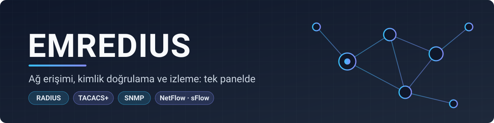
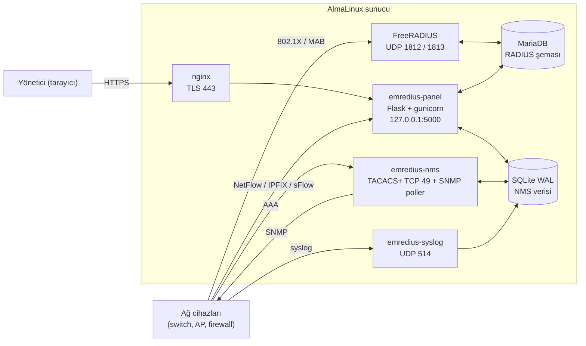

<div align="center">

**[English](README.md)** · Türkçe



<br>


[](https://github.com/sponsors/emreyigit-tasdelen)
[](https://buymeacoffee.com/emreyigit.tasdelen)

**RADIUS kullanıcı yönetimi, TACACS+ AAA sunucusu ve SNMP tabanlı ağ izleme (NMS) tek bir web panelinde.**
802.1X ve MAC doğrulama, cihaz keşfi, topoloji, NetFlow/sFlow, syslog, alarmlar ve 5651 uyumlu imzalı kayıt arşivi.

[Hızlı başlangıç](#-hızlı-başlangıç) · [Mimari](#-mimari) · [Özellikler](#-özellikler) · [Yapılandırma](#-yapılandırma) · [API](#-rest-api) · [Dokümanlar](#-dokümanlar)

</div>

---

## Ne işe yarar?

Kurumsal bir ağda üç ayrı soru vardır: *kim bağlanabilir* (RADIUS, 802.1X), *yöneticiler cihazda hangi komutu çalıştırabilir* (TACACS+), *ağ şu an nasıl davranıyor* (SNMP, akış, syslog). EMREDIUS bunları ayrı araçlara bölmek yerine tek panelde toplar ve aralarında bağlantı kurar: bir MAC adresinden cihaz portuna, oradan RADIUS oturumuna ve kullanıcıya geçilebilir.

- **FreeRADIUS'un önüne değil, yanına oturur.** Panel, FreeRADIUS'un kendi SQL şemasını yönetir; panel kapalıyken kimlik doğrulama sürer.
- **Hepsi AlmaLinux üzerinde, ayrı systemd süreçleri olarak** çalışır; ortak depo MariaDB (RADIUS) ve SQLite WAL (NMS).
- **Güvenlik varsayılan:** CSRF, rol tabanlı yetki, iki adımlı doğrulama, IP başına giriş kilidi, güvenlik başlıkları, işlem denetim kaydı.

<!-- Ekran görüntüleri eklenince bu bloğu açın (dosyalar docs/assets/ altına konur):
<p align="center">
  
  
</p>
-->

## 🏗 Mimari



| Süreç | Giriş noktası | Port | Rolü |
|---|---|---|---|
| `emredius-panel` | `wsgi:app` (gunicorn, 1 worker x 16 thread) | 127.0.0.1:5000 (nginx arkasında) | web arayüzü, REST API, akış toplayıcı (UDP 2055, 4739, 6343) |
| `emredius-nms` | `python -m nms.runner` | TCP 49, SNMP poller | TACACS+ AAA, keşif, telemetri, alarm |
| `emredius-syslog` | `python -m nms.syslogd` | UDP 514 | syslog toplama |
| FreeRADIUS | sistem paketi | UDP 1812 / 1813 | 802.1X / MAB kimlik doğrulama ve muhasebe |
| systemd timer'lar | `scripts/maintenance.py`, `scripts/update_oui.py`, `scripts/backup_verify.sh` | - | günlük 5651 arşivi, aylık OUI tablosu, yedek geri-yükleme testi |

Tasarım gerekçeleri, panel katmanları, dizilim şemaları (RADIUS, TACACS+, SNMP keşif), durum makinesi ve ER diyagramları: **[docs/architecture.md](docs/architecture.md)**.

## ✨ Özellikler

| Alan | Neler var |
|---|---|
| **Kimlik doğrulama** | RADIUS kullanıcı/grup/profil, NAS, MAC doğrulama, kupon üretimi, oturumlar, TACACS+ (PAP/CHAP/ASCII, ayrıcalık 0-15, regex komut yetkilendirme, komut muhasebesi), RADIUS test aracı |
| **Keşif ve envanter** | SNMP CIDR keşfi (v2c/v3), envanter ve zamanlanmış aralık taraması, IP ve port tarama, IPAM |
| **Ağ görünürlüğü** | LLDP/CDP topoloji haritası, port ve MAC tabloları, şasi/modül bilgisi, ekipman sağlığı ve trafik, döngü tespiti, MAC tarama ve MAC alarmları |
| **Trafik ve olaylar** | NetFlow v5/v9, IPFIX, sFlow analizi, syslog, eşik tabanlı alarmlar, SIEM ve entegrasyonlar, servis sağlığı |
| **Yönetim** | cihaz konfig yedekleme ve karşılaştırma, konfig denetimi, raporlar, özel panolar, yedekleme, çok kiracılık, düzenlenebilir yetki matrisi, sertleştirme ayarları |
| **Uyumluluk** | işlem denetim günlüğü, günlük imzalı 5651 kayıt arşivi ve doğrulaması |
| **Arayüz** | koyu/açık tema, mobil uyumlu, canlı güncelleme, CSV/JSON dışa aktarma, çok dilli arayüz |

Menü → URL → servis → şablon → test eşlemesi: [docs/MODULES.md](docs/MODULES.md).

## 🧰 Teknoloji yığını

| Bileşen | Teknoloji | Sürüm | Rolü |
|---|---|---|---|
| Dil | Python | 3.12 | tüm panel ve NMS kodu |
| Web | Flask, Jinja2, Werkzeug | 3.1.3, 3.1.6, 3.1.9 | uygulama, şablonlar |
| Sunucu | gunicorn (gthread) | 23.0.0 | WSGI, tek worker + 16 thread |
| RADIUS deposu | MariaDB + PyMySQL | PyMySQL 1.1.1 | FreeRADIUS şeması |
| NMS deposu | SQLite (WAL) | Python ile gelir | envanter, telemetri, alarm, syslog, akış |
| Kriptografi | cryptography, bcrypt, PyNaCl | 50.0.0, 5.0.0, 1.6.2 | SNMPv3, TACACS+, parola özetleri |
| SSH | paramiko | 5.1.0 | cihaz konfig yedekleme ve CLI |
| Ağ protokolleri | asyncio ile kendi uygulaması | - | TACACS+ (RFC 8907), SNMPv2c/v3, NetFlow/IPFIX/sFlow ayrıştırıcıları |
| Sistem | nginx, systemd, firewalld, SELinux | - | TLS, süreçler, ağ filtresi |

## 🚀 Hızlı başlangıç

Geliştirme ortamı (veritabanı gerekmez; testler erişilemeyen DB'ye karşı da çalışacak şekilde yazılmıştır):

```bash
git clone https://github.com/emreyigit-tasdelen/EMredius.git
cd EMredius
python -m venv .venv && source .venv/bin/activate     # Windows: .venv\Scripts\activate
pip install -r requirements.txt pytest

python -m pytest -q tests/test_core.py                # 19 test, yaklaşık 35 sn
```

Panelin geliştirme sunucusunu başlatmak için (giriş sayfası açılır; hesap doğrulama ve çoğu menü MariaDB ve Linux hesapları ister):

```bash
EMREDIUS_ENV_FILE=/dev/null SECRET_KEY=$(python -c "import secrets;print(secrets.token_hex(32))") \
SESSION_COOKIE_SECURE=0 START_BACKGROUND_JOBS=0 python wsgi.py
# → http://127.0.0.1:5100/login
```

Sunucu kurulumu (AlmaLinux, MariaDB, FreeRADIUS, nginx, systemd) için [docs/KURULUM.md](docs/KURULUM.md). Birim dosyaları `deploy/systemd/` altındadır:

```bash
systemctl enable --now emredius-panel.socket emredius-panel.service emredius-nms emredius-syslog
```

## ⚙️ Yapılandırma

Ayarlar ortam değişkenlerinden okunur; `EMREDIUS_ENV_FILE` (varsayılan `/etc/emredius/emredius.env`) içindeki `KEY=VALUE` satırları, tanımlı olmayan değişkenleri doldurur. Örnek: [`deploy/emredius.env.example`](deploy/emredius.env.example).

<details>
<summary>Ortam değişkenleri tablosu</summary>

| Değişken | Varsayılan | Açıklama |
|---|---|---|
| `EMREDIUS_ENV_FILE` | `/etc/emredius/emredius.env` | ortam dosyası yolu |
| `SECRET_KEY` / `SECRET_KEY_FILE` | `/etc/emredius/secret_key` | oturum anahtarı; yoksa dosyaya 0600 ile üretilir |
| `SESSION_COOKIE_SECURE` | `1` | HTTPS dışında çerez göndermez |
| `DB_HOST`, `DB_PORT` | `127.0.0.1`, `3306` | MariaDB adresi |
| `DB_USER`, `DB_NAME` | `radius`, `radius` | MariaDB kullanıcısı ve şeması |
| `DB_PASSWORD` | (yok) | verilmezse FreeRADIUS `sql` modülü yapılandırmasından okunur |
| `DB_POOL_SIZE` | `8` | bağlantı havuzu |
| `NMS_DB_PATH` | `nms/data/enterprise_nms.db` | NMS SQLite dosyası |
| `START_BACKGROUND_JOBS` | `1` | zamanlayıcılar ve toplayıcılar |
| `SYSTEM_DRY_RUN` | `0` | `1` iken sunucuyu değiştiren komutlar engellenir (staging) |
| `ARCHIVE_5651_DIR` | `/var/lib/emredius/5651` | imzalı günlük arşiv dizini |
| `BACKUP_DIR` | `/var/backups/radius` | yedek dizini |
| `PANEL_UNIT` | `emredius-panel.service` | Hizmetler sayfasındaki yeniden başlatma hedefi |
| `EMREDIUS_BIND` | `127.0.0.1:5000` | gunicorn bağlama adresi |
| `EMREDIUS_THREADS` | `16` | gunicorn thread sayısı |
| `FLOW_EXTRA_PORTS` | `4739` | IPFIX için ek UDP portları (boş değer kapatır) |
| `LOG_LEVEL` | `INFO` | günlük düzeyi |

Parola ve anahtar değerleri depoya girmez; `*.env` dosyaları `.gitignore`'dadır.

</details>

## 🔌 REST API

`/api/v1/*` uçları `X-API-Key` başlığı veya `Authorization: Bearer <token>` ister. Etkileşimli belge giriş yapmış yöneticiye `/api/docs` (Swagger UI), şema `/api/openapi.json` adresinde sunulur.

```bash
curl -s -H "X-API-Key: $EMREDIUS_API_KEY" https://panel.example/api/v1/stats
# {"status": "success", "radiusd_status": "...", ...}
```

<details>
<summary>Uç noktalar</summary>

| Yöntem | Yol | Açıklama |
|---|---|---|
| GET, POST | `/api/v1/users` | RADIUS kullanıcıları |
| DELETE | `/api/v1/users/<ad>` | kullanıcı sil |
| GET | `/api/v1/sessions` | oturumlar |
| GET | `/api/v1/stats` | genel istatistik |
| GET | `/api/v1/health` | ekipman sağlığı |
| GET | `/api/v1/health/radiolink` | radyo bağlantı sağlığı |
| GET | `/api/v1/topology` | topoloji düğüm ve kenarları |
| GET | `/api/v1/inventory/devices` | envanter cihazları |
| GET | `/api/v1/equipment/<tür>` | port, MAC, şasi |
| GET | `/api/v1/macscan` | MAC tarama |
| GET | `/api/v1/alarms` | alarmlar |
| GET | `/api/v1/loops` | döngü tespiti |
| GET | `/api/v1/flows/top` | en çok trafik üretenler |
| GET | `/api/v1/boards`, `/api/v1/boards/<id>` | özel panolar |
| GET | `/api/v1/configs/compliance` | konfig uyumluluğu |
| GET | `/api/v1/ipam/subnets`, `/api/v1/ippools`, `/api/v1/apn`, `/api/v1/watch` | IPAM, havuzlar, APN, izleme |

</details>

SNMP keşfi panel arayüzünün kendi ucunu kullanır: `POST /api/snmp/discovery/scan` (1024 adrese kadar senkron; daha büyük aralıklar arka plan işi olarak çalışır, süper yönetici için sınır yoktur) ve ilerleme için `GET /api/snmp/discovery/scan/<job_id>`.

## 📁 Proje yapısı

```
emredius/
├── wsgi.py · gunicorn.conf.py · requirements.txt
├── emredius/                  Flask uygulaması
│   ├── __init__.py            uygulama fabrikası, blueprint ve zamanlayıcı kaydı
│   ├── config.py              ortam tabanlı yapılandırma
│   ├── core/                  auth, rbac, csrf, güvenlik başlıkları, tenant, sistem çağrıları
│   ├── blueprints/<menü>/     HTTP katmanı (routes.py), menü başına bir paket
│   ├── services/<menü>.py     iş mantığı
│   ├── templates/<menü>/      Jinja şablonları
│   └── static/                js, css, vendor (Swagger UI dahil)
├── nms/                       NMS paketi (ayrı süreçler)
│   ├── snmp/                  keşif, motor (v2c/v3), poller, telemetri, alarm, webhook
│   ├── tacacs/                TACACS+ AAA sunucusu
│   ├── syslogd/               syslog toplayıcı
│   ├── web/                   NMS API uçları
│   └── common/                SQLite şeması ve ortak kod
├── tests/                     menü başına pytest dosyası + run_tests.py
├── scripts/                   healthcheck, smoke, yedek, bakım, new_menu.py
├── deploy/                    systemd birimleri, SELinux, örnek env dosyaları
└── docs/                      mimari, modül indeksi, güvenlik notları
```

## 🧪 Geliştirme

```bash
python -m pytest -q tests                       # tam paket (Linux önerilir; Windows’ta uzun sürer)
python tests/run_tests.py [modül ...]           # pytest'siz hızlı çalıştırıcı
python scripts/new_menu.py <ad> "<Başlık>"      # yeni menü iskeleti (blueprint + servis + şablon + test)
python scripts/new_menu.py --index              # docs/MODULES.md'yi yeniden üretir
python scripts/healthcheck.py && python scripts/smoke.py   # sağlık ve rota taraması
```

Kural: yeni özellik = yeni blueprint + servis + şablon + test; HTML Jinja şablonunda yazılır, SQL parametreli, her route yetki denetiminden geçer.

## 🔒 Güvenlik ve sınırlar

- Oturum çerezi HttpOnly, Secure, SameSite=Lax; ömür 30 dakika. CSRF jetonu ve güvenlik başlıkları (HSTS, CSP bölümleri, Permissions-Policy) her istekte uygulanır.
- Roller: süper yönetici, ağ yöneticisi, operatör, denetçi (salt okunur); sayfa yetkileri yetki matrisinden düzenlenir.
- Firewalld'da UDP 514, 6343, 2055 ve 4739 yalnız RFC1918 kaynaklara açık olacak şekilde yapılandırılır.
- Panel tek gunicorn süreciyle çalışacak şekilde tasarlandı (giriş kilidi sayaçları süreç içindedir); yatay ölçekleme hedeflenmedi.
- Hedef platform AlmaLinux'tur; geliştirme sunucusu Windows'ta açılır ama Linux hesap doğrulaması ve sistem çağrıları çalışmaz.
- Güvenlik denetimleri ve tarama sonuçları: [docs/GUVENLIK_TARAMA.md](docs/GUVENLIK_TARAMA.md), bildirim politikası: [SECURITY.md](SECURITY.md).

## 📚 Dokümanlar

| Belge | İçerik |
|---|---|
| [docs/architecture.md](docs/architecture.md) | bileşenler, akışlar, veri modeli, güvenlik katmanları |
| [docs/MODULES.md](docs/MODULES.md) | menü → URL → servis → şablon → test indeksi |
| [docs/KURULUM.md](docs/KURULUM.md) | kurulum rehberi |
| [nms/PROJECT.md](nms/PROJECT.md) | NMS özellik envanteri (TACACS+ ve SNMP; İngilizce) |

## 🤝 Katkı ve lisans

Katkı için [Geliştirme](#-geliştirme) bölümündeki akışı izleyin: her değişiklik ilgili testle birlikte gelir. Lisans: [AGPL-3.0](LICENSE).

## 💖 Destek

EMREDIUS ücretsiz ve açık kaynaklıdır. İşinize yaradıysa geliştirilmesine destek olabilirsiniz:

- [GitHub Sponsors](https://github.com/sponsors/emreyigit-tasdelen)
- [Buy Me a Coffee](https://buymeacoffee.com/emreyigit.tasdelen)

**Geliştirici: [Emre Yiğit Taşdelen](https://github.com/emreyigit-tasdelen)**
