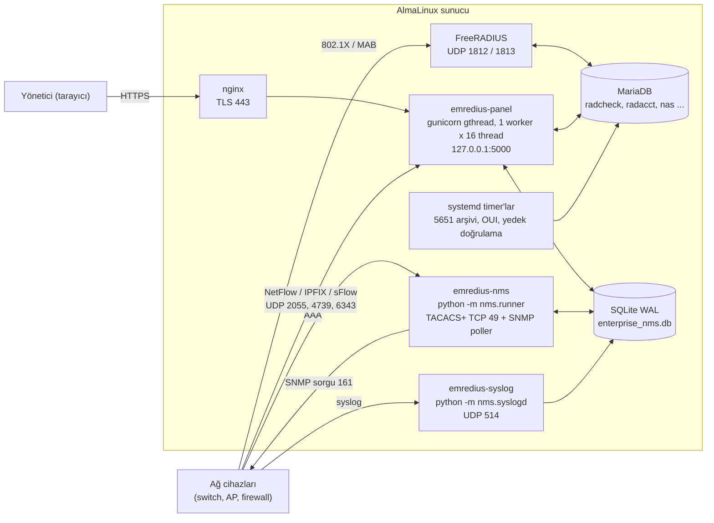
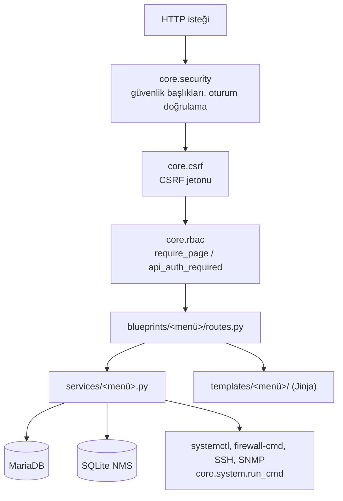
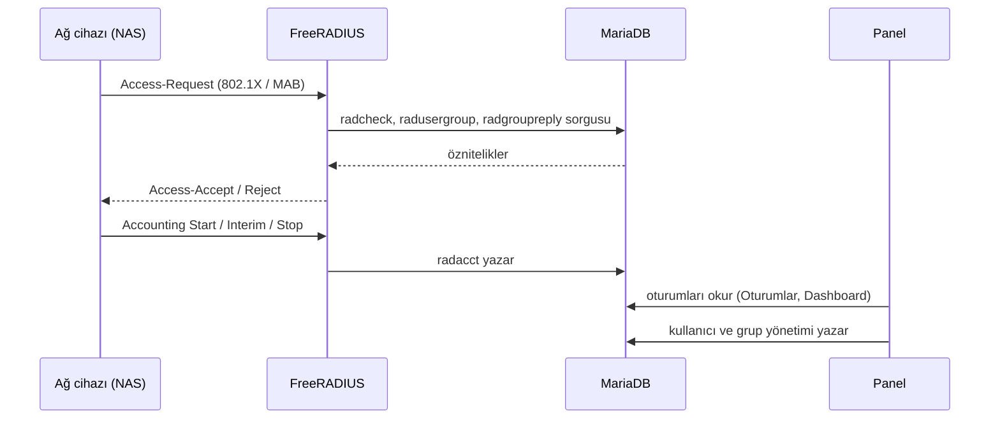
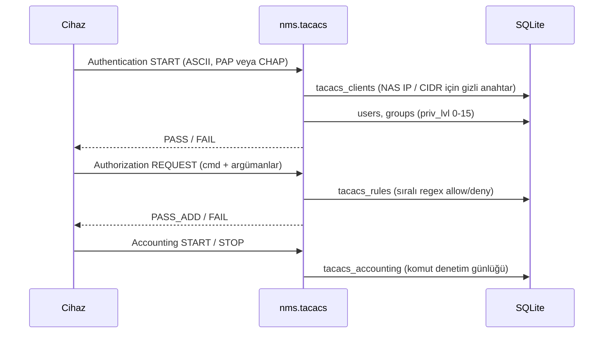
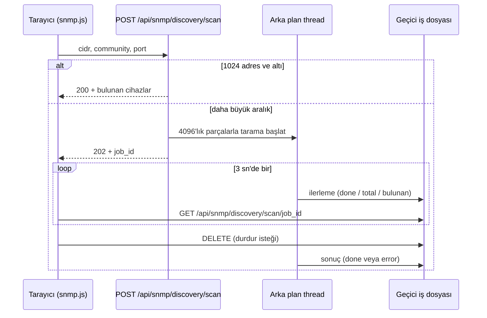
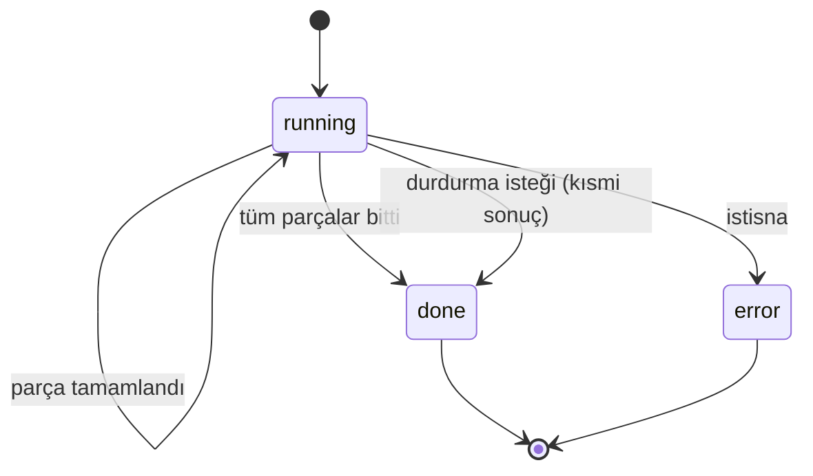
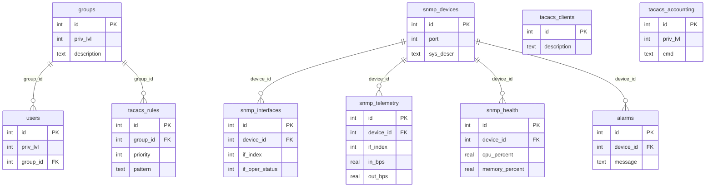
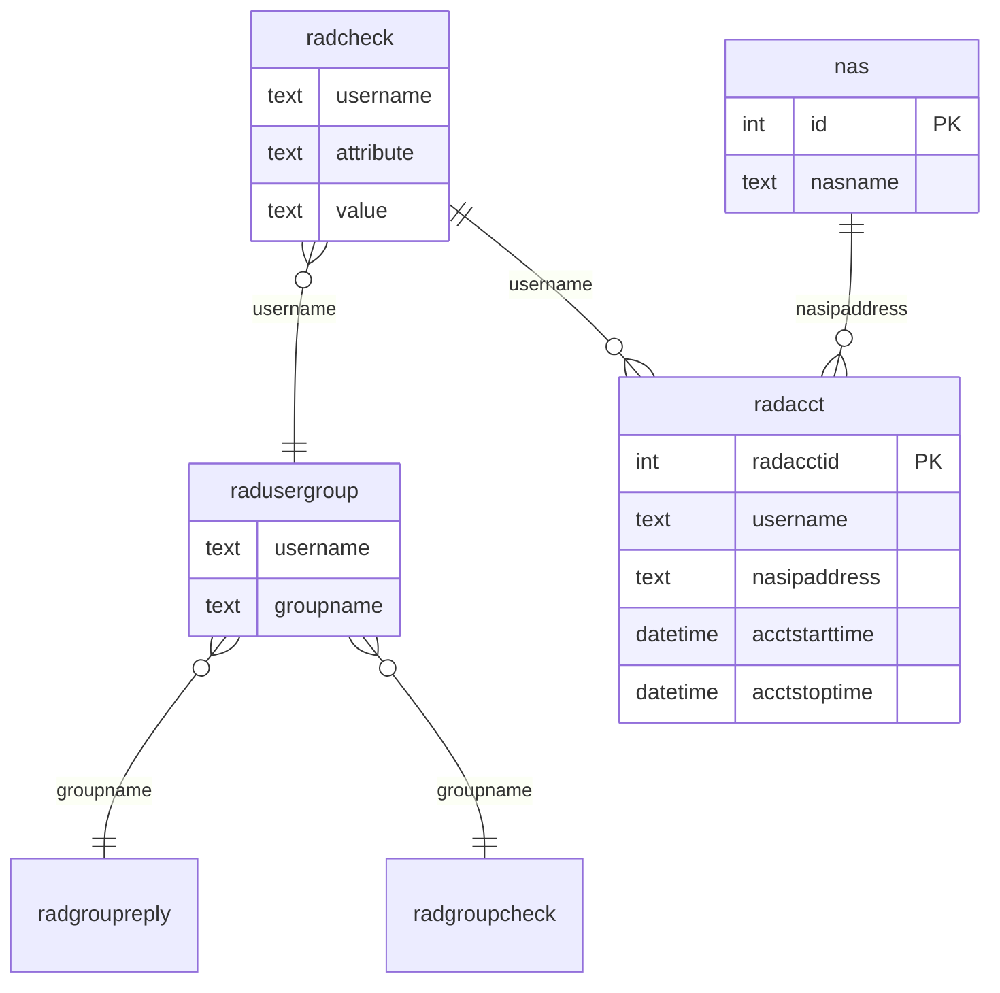

# Mimari

Bu belge EMREDIUS'un bileşenlerini, veri akışlarını ve veri modelini teknik düzeyde anlatır. Kurulum ve çalıştırma için [README](../README.md), menü → URL indeksi için [MODULES.md](MODULES.md).

## 1. Bileşenler ve süreçler

Sistem tek sunucuda (AlmaLinux) birkaç bağımsız systemd süreci olarak çalışır. Süreçler birbirini çağırmaz; ortak durum iki veritabanındadır: FreeRADIUS'un **MariaDB** şeması ve NMS için **SQLite (WAL)**.

| Süreç | Giriş noktası | Dinlediği port | Yazdığı depo |
|---|---|---|---|
| Panel | `wsgi:app` (`gunicorn -c gunicorn.conf.py`) | 127.0.0.1:5000 (nginx arkasında); akış toplayıcı thread'i UDP 2055, 4739, 6343 | MariaDB, SQLite |
| NMS | `nms.runner` (`DaemonSupervisor`) | TACACS+ TCP 49, SNMP poller | SQLite |
| Syslog | `nms.syslogd` | UDP 514 | SQLite (`syslog_msgs`) |
| Zamanlayıcılar | `scripts/maintenance.py archive5651`, `scripts/update_oui.py`, `scripts/backup_verify.sh` | - | dosya arşivi, MariaDB |

Birim dosyaları `deploy/systemd/` altındadır.

### Neden bu tasarım?

- **Tek gunicorn worker, çok thread.** Giriş denemesi sayaçları, ayar önbelleği ve arka plan işleri süreç başına tutulur. Tek süreç bunları tutarlı kılar; trafik düşük ve G/Ç ağırlıklı olduğu için thread yeterlidir (`gunicorn.conf.py`).
- **FreeRADIUS şemasına dokunmadan yönetim.** Panel, FreeRADIUS'un kendi SQL şemasını (`radcheck`, `radreply`, `radusergroup`, `radacct`, `nas`, ...) okur/yazar. RADIUS tarafı kendi sürecinde ve kendi performansıyla çalışır; panel çökse bile kimlik doğrulama sürer. DB parolasının tek kaynağı FreeRADIUS'un `sql` modülü yapılandırmasıdır (`emredius/config.py`).
- **NMS için SQLite WAL.** Telemetri, envanter, alarm ve syslog tek dosyada; çok süreçli okuma kilitlenmez. TACACS+ sırları ve SNMP community'leri bu dosyada olduğu için `nms/data/` ve `*.db` `.gitignore`'dadır.
- **Menü = blueprint + servis + şablon + test.** İş mantığı `services/`, HTTP katmanı `blueprints/`, görünüm `templates/` altındadır; her menünün kendi test dosyası vardır (`scripts/new_menu.py` iskelet üretir).

## 2. Panel katmanları

- **Roller** (`core/auth.py`): `superadmin`, `network_admin`, `helpdesk`, `auditor` (salt okunur). Sayfa yetkileri düzenlenebilir yetki matrisindedir (`/permissions`).
- **Kimlik:** web hesapları (hash'li), Linux sistem hesapları (`/etc/shadow`) ve iki adımlı doğrulama (`/login-2fa`). IP başına kaba kuvvet kilidi vardır.
- **Çok kiracılık:** envanter, akış, MAC tarama gibi NMS tabloları `tenant_id` taşır (`core/tenant.py`).
- **Güvenli sistem çağrıları:** sunucuyu değiştiren komutlar `core.system.run_cmd` üzerinden geçer; `SYSTEM_DRY_RUN=1` ile staging'de engellenir.

## 3. Ana akışlar

### 3.1 RADIUS kimlik doğrulama ve oturum

### 3.2 TACACS+ yönetici erişimi (RFC 8907)

### 3.3 SNMP keşif ve izleme

CIDR keşfi (`nms/snmp/discovery.py`) cihazlara sırayla v2c/v3 kimlik bilgisi dener, `sysObjectID` ile üreticiyi tanır ve arayüzleri tarar. Panel tarafındaki uç (`nms/web/routes_snmp.py`): 1024 adrese kadar istek içinde senkron, daha büyük aralıklar (süper yönetici için sınırsız) arka plan işi olarak çalışır.

İş durumu geçici bir JSON dosyasında tutulur; bu sayede durum sorgusunu hangi süreç/thread karşılarsa karşılasın aynı sonucu görür.

Sürekli izleme `nms/snmp/poller.py` içindedir: arayüz sayaçlarından bps/pps/hata hızı (`snmp_telemetry`), CPU/bellek/sıcaklık (`snmp_health`) ve eşik kuralları (`nms/snmp/alarms.py`, `alarms` tablosu) üretir.

### 3.4 Akış ve syslog toplama

- **NetFlow v5/v9, IPFIX, sFlow:** panel sürecindeki toplayıcı (`services/flows.py`) UDP 2055, 4739 ve 6343'ü dinler, paketleri dakika bazında `flow_rollup` tablosunda toplar. Kaynak IP izin listesi `services/flow_acl.py` ve Sertleştirme menüsündedir.
- **Syslog:** `nms.syslogd` UDP 514'ü dinler, mesajları `syslog_msgs` tablosuna yazar; gönderici izin listesi `syslog_cfg` anahtarındadır.
- `nms/netflow/` ayrı bir toplayıcı sürecidir; panelin toplayıcısı tek toplayıcı olduğu için kurulu servisi yoktur ve portlar çakışacağından birlikte çalıştırılmamalıdır.

## 4. Veri modeli

### 4.1 NMS (SQLite, `nms/common/db.py`)

Menü başına eklenen tablolar (`inv_*`, `topo_links`, `eq_*`, `flow_rollup`, `syslog_msgs`, `alm_*`, `ipam_*`, `cfg_*`, `ms_*`, `mxa_*`) aynı SQLite dosyasındadır ve `tenant_id` taşır. Şema, ilgili servis modülünün başındaki `CREATE TABLE IF NOT EXISTS` ifadelerinde tanımlıdır.

### 4.2 RADIUS (MariaDB, FreeRADIUS standart şeması)

Şemanın sahibi FreeRADIUS'tur. Bu diyagram yalnızca panelin kullandığı tabloları ve ilişkileri gösterir; panel ayrıca `radreply` ve `radpostauth` tablolarını da kullanır.

## 5. Güvenlik katmanları

| Katman | Uygulama |
|---|---|
| Taşıma | nginx TLS; panel yalnızca 127.0.0.1'e bağlı |
| Oturum | HttpOnly, Secure, SameSite=Lax çerez; 30 dk ömür; `SECRET_KEY` dosyası 0600 |
| İstek | CSRF jetonu, güvenlik başlıkları (HSTS, CSP bölümleri, Permissions-Policy) |
| Yetki | rol + sayfa matrisi, REST için `X-API-Key` veya `Bearer` |
| Denetim | yönetici işlemleri denetim kaydına yazılır; günlük imzalı 5651 arşivi |
| Ağ | firewalld: UDP 514, 6343, 2055, 4739 yalnız RFC1918 kaynaklara açık |
| SELinux | dosya etiketleri `restorecon` ile düzeltilir; yönerge ve yedek betiği `deploy/selinux/` |

Ayrıntılı bulgu listesi: [GUVENLIK_TARAMA.md](GUVENLIK_TARAMA.md).
